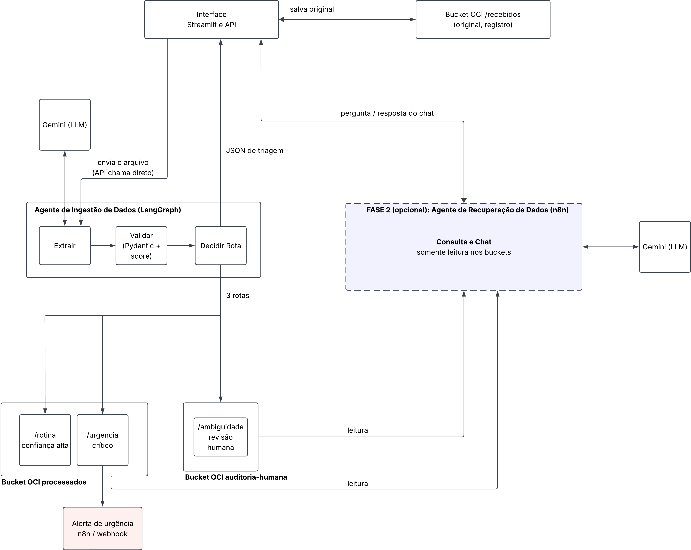
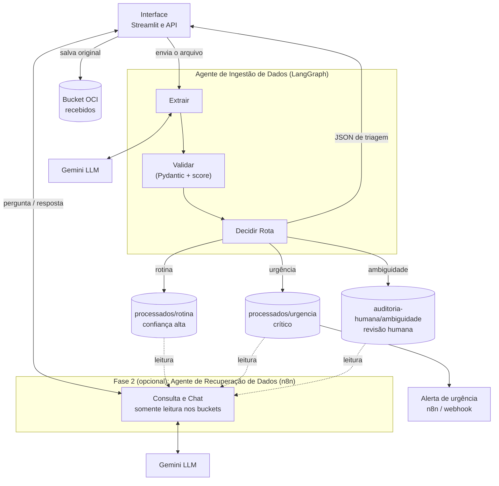

# MediFlow – G10 Equipo 7

Agente Autônomo para Triagem, Extração e Roteamento de Documentos Clínicos

Triagem automática de documentos médicos com um agente de IA. O documento entra, o agente extrai os dados, valida e decide para onde ele vai: **rotina**, **urgência** ou **ambiguidade** (revisão humana).

> Status: documento em construção. Seções marcadas com **(a definir)** dependem de issues em andamento.

A API já funciona localmente com agente simulado e armazenamento em disco. Veja o [guia da API](docs/api.md) para iniciar o servidor, enviar seus próprios arquivos e conferir os resultados. A extração real com Gemini, o armazenamento OCI e o envio de alertas ainda dependem das próximas integrações.

## 1. Problema e objetivo

Documentos médicos (receituários, laudos, exames) chegam em formatos variados: PDF, imagem ou texto. Tratar todos do mesmo jeito atrasa os casos críticos e deixa passar leituras duvidosas.

**Objetivo:** receber o documento, extrair as informações com um LLM, validar a saída e encaminhá-lo automaticamente, garantindo que:

- casos de rotina sejam arquivados sem intervenção;
- casos urgentes disparem um alerta;
- casos duvidosos passem por uma pessoa.

Todos os dados de teste são **fictícios**.

## 2. Arquitetura



*A Fase 2 (agente de consulta e chat, tracejada no diagrama) é opcional e não faz parte do MVP.*

A mesma arquitetura em Mermaid (editável no próprio README):



### Blocos

| Bloco | Função |
|---|---|
| **Interface (Streamlit e API)** | Recebe PDF, imagem ou JSON, chama o agente diretamente e devolve o JSON de triagem. |
| **Bucket `recebidos`** | Guarda o original e serve de registro de tudo que entrou. |
| **Extrair** | Envia o documento ao Gemini e obtém os campos estruturados. |
| **Validar** | Confere a extração com os contratos Pydantic e calcula o score de confiança. |
| **Decidir Rota** | Aplica as regras de triagem e escolhe uma das 3 rotas. |
| **Bucket `processados`** | Pastas `rotina` (confiança alta) e `urgencia` (crítico). |
| **Bucket `auditoria-humana`** | Pasta `ambiguidade`, para revisão humana. |
| **Alerta de urgência** | Webhook/n8n acionado depois de gravar em `urgencia`. Se falhar, a triagem não pode cair. |
| **Fase 2 (opcional)** | Agente de consulta e chat com acesso somente leitura aos buckets. |

## 3. Fluxo e as 3 rotas

1. A pessoa envia o documento pela interface ou pela API.
2. O original é salvo em `recebidos`.
3. O agente executa **Extrair → Validar → Decidir Rota**.
4. O resultado é gravado na pasta da rota escolhida e o JSON de triagem volta para a interface.

| Rota | Quando | Destino | Efeito extra |
|---|---|---|---|
| **Rotina** | Documento completo, sem gravidade, confiança alta | `processados/rotina` | Nenhum |
| **Urgência** | Achado crítico no conteúdo | `processados/urgencia` | Dispara o alerta |
| **Ambiguidade** | Dados ilegíveis, ausentes ou confiança baixa | `auditoria-humana/ambiguidade` | Revisão humana |

## 4. Regras de triagem (a definir)

Dependem da issue #5. Pontos em aberto:

- Limiar de score de confiança que separa rotina de ambiguidade.
- Critérios que caracterizam um achado crítico.
- **Documento urgente e de baixa confiança:** vai para auditoria humana, dispara o alerta, ou os dois?

## 5. Decisões

Registro das decisões de arquitetura. Data: 19/10/2026 (fechamento da arquitetura).

| Tema | Decisão | Alternativa / observação |
|---|---|---|
| Núcleo do agente | Python com LangGraph (Extrair, Validar, Decidir Rota) | n8n fica só na Fase 2 (opcional) e nos alertas |
| Buckets | 3 buckets: `recebidos`, `processados` (pastas `rotina` e `urgencia`) e `auditoria-humana` (pasta `ambiguidade`) | Alternativa: 1 bucket só, separado por prefixos. Escolhemos 3 para separar o original, o resultado e a fila de revisão humana |
| Gatilho de entrada | A API chama o agente diretamente | Alternativa descartada: disparar o agente por upload no bucket |
| Docker e VM | Ficam para uma sprint posterior (diferencial, fora do MVP) | O MVP roda local |
| Chaves de API | Pessoais, por variável de ambiente, nunca no código ou no chat | #3 |
| Alerta de urgência | A falha do alerta não derruba a triagem | #13 |

**Em aberto:**

- Documento urgente e de baixa confiança: vai para auditoria humana, dispara o alerta, ou os dois? (#5)
- O n8n consegue ler os buckets da OCI? Risco da Fase 2, em validação (#12).

O histórico completo fica em [`docs/decisoes.md`](docs/decisoes.md).

## 6. Estrutura e como rodar

```
mediflow/
├── app/            # interface Streamlit (app.py, .streamlit/config.toml)
├── api/            # API FastAPI: POST /triagem (#9)
├── agent/          # grafo LangGraph, nós, contratos e regras
│   ├── nodes/      # extrair.py, validar.py, decidir_rota.py
│   ├── schemas.py  # contratos Pydantic (#1)
│   └── rules.py    # regras de triagem (#5)
├── storage/        # armazenamento local e integração futura com OCI
├── alerts/         # alerta de urgência (#13)
├── n8n/            # workflows do n8n
├── data/sinteticos/# documentos fictícios de teste (#4)
├── docs/           # wireframes e registro de decisões
└── tests/
```

**Pré-requisitos para testar a API:** Python 3.11+. O modo padrão (`mock`) funciona sem chave Gemini e sem conta OCI. Execute os comandos na raiz do projeto:

```bash
python3 -m venv .venv
source .venv/bin/activate        # Windows: .venv\Scripts\activate
python -m pip install -r requirements.txt
```

Se ainda não existir um `.env`, copie `.env.example` para `.env`. Se já existir, preserve seu conteúdo e confira estas configurações:

```dotenv
AGENT_MODE=mock
STORAGE_LOCAL_DIR=.local/storage
AGENT_TIMEOUT_SECONDS=30
```

A API lê o `.env` da raiz; variáveis já exportadas no terminal têm prioridade. Inicie o servidor:

```bash
python -m uvicorn api.main:app --reload
```

Abra <http://127.0.0.1:8000/docs> para escolher um arquivo e testar `POST /triagem`. Para um PDF ou imagem seu, selecione `caso_mock=rotina`, `urgencia` ou `ambiguidade`: o conteúdo ainda não passa por OCR ou análise de IA. Os exemplos com `curl`, JSON próprio e integração do front estão no [guia da API](docs/api.md).

Em outro terminal, com o ambiente ativado:

```bash
# Interface: ainda funciona com seus próprios mocks, até conectar a função triar à API.
streamlit run app/app.py

# Testes automatizados: usam diretórios temporários, sem gravar nos buckets locais.
python -m pytest -q
```

Nunca commite o `.env`. Veja o `CONTRIBUTING.md` para o fluxo de branch e PR.

## 7. Cenários da demo

Três documentos fictícios, em `data/sinteticos/`, cobrem as 3 rotas. Enviados à API em modo `mock`, seus IDs selecionam automaticamente os cenários abaixo: o original vai para `recebidos` e o resultado é salvo no destino da rota. A tela Streamlit ainda mantém sua simulação independente.

**Cenário 1: rotina** (`doc_teste_001_rotina.json`)

- Entrada: receituário completo de controle de hipertensão (paciente, médico com CRM e prescrição legíveis).
- Resultado esperado: confiança alta, nenhum sinal de gravidade. Rota **rotina**, gravado em `processados/rotina`, sem alerta.

**Cenário 2: urgência** (`doc_teste_002_urgencia.json`)

- Entrada: laudo de tomografia com achado compatível com hemorragia subaracnoidea aguda e recomendação de avaliação neurocirúrgica imediata.
- Resultado esperado no mock: rota **urgência**, gravado em `processados/urgencia` e `alerta_enviado=true` simulado. Nenhum webhook é chamado; o envio real de alertas pertence à issue #13.

**Cenário 3: ambiguidade** (`doc_teste_003_ambiguidade.json`)

- Entrada: receituário digitalizado com baixa qualidade: nome, CRM e dose ilegíveis ("5 ou 50 mg"), diagnóstico não informado.
- Resultado esperado: confiança baixa. Rota **ambiguidade**, gravado em `auditoria-humana/ambiguidade` para revisão humana, sem alerta.

O mock usa scores fixos de 0,96 (rotina), 0,93 (urgência) e 0,41 (ambiguidade). São exemplos para integração; o cálculo real depende da implementação das regras de triagem.
| Arquivo | Rota | Destino principal | Bucket | Revisão humana | Alerta |
|---|---|---|---|---|---|
| `doc_teste_001_rotina.json` | `/rotina` | `Farmacia_Hospitalar` | `processados` | não | não |
| `doc_teste_002_urgencia.json` | `/urgencia` | `Fila_Emergencia_Medica` | `processados` | não (se score ≥ 0,85) | sim |
| `doc_teste_003_ambiguidade.json` | `/ambiguidade` | `Fila_Revisao_Humana` | `auditoria-humana` | sim | não |

## 8. Limitações e próximos passos

- Projeto de simulação, não é uso clínico: não substitui avaliação médica.
- Somente dados fictícios.
- Próximos passos: concluir o MVP, validar a Fase 2 (chat de consulta) e, como diferencial, o deploy em VM com Docker.

## Equipe

G10 Brasil – Equipo 7 (No Country).
