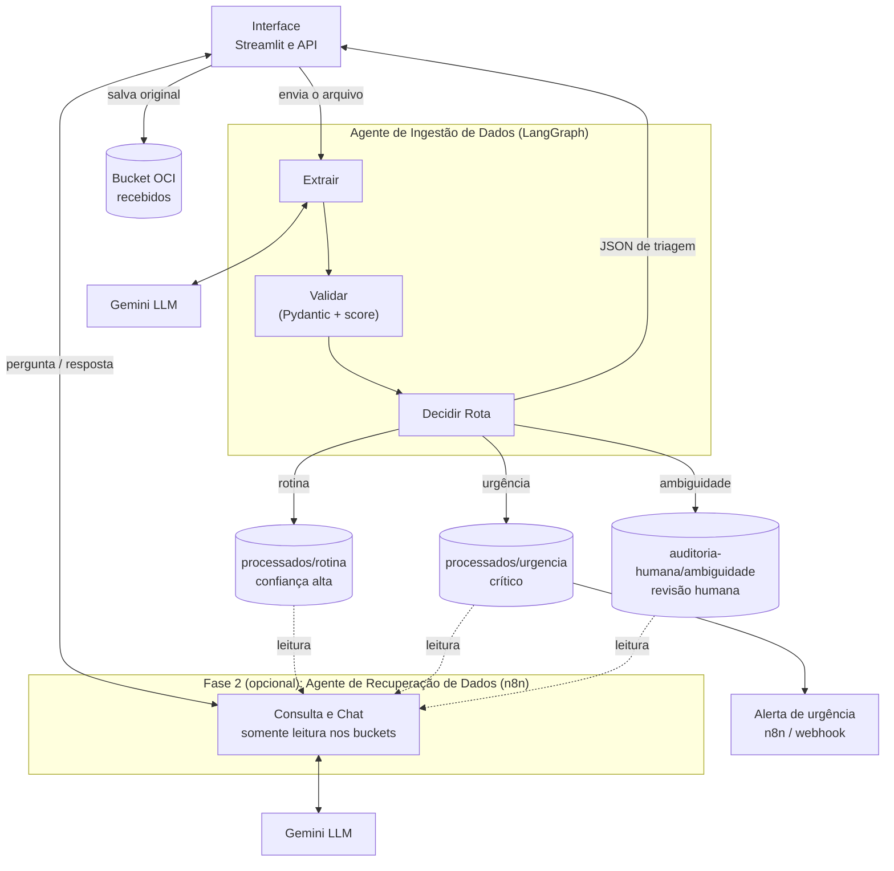

# MediFlow – G10 Equipo 7

Triagem automática de documentos médicos com um agente de IA. O documento entra, o agente extrai os dados, valida e decide para onde ele vai: **rotina**, **urgência** ou **ambiguidade** (revisão humana).

> Status: documento em construção. Seções marcadas com **(a definir)** dependem de issues em andamento.

## 1. Problema e objetivo

Documentos médicos (receituários, laudos, exames) chegam em formatos variados: PDF, imagem ou texto. Tratar todos do mesmo jeito atrasa os casos críticos e deixa passar leituras duvidosas.

**Objetivo:** receber o documento, extrair as informações com um LLM, validar a saída e encaminhá-lo automaticamente, garantindo que:

- casos de rotina sejam arquivados sem intervenção;
- casos urgentes disparem um alerta;
- casos duvidosos passem por uma pessoa.

Todos os dados de teste são **fictícios**.

## 2. Arquitetura



### Blocos

| Bloco | Função |
|---|---|
| **Interface (Streamlit e API)** | Recebe PDF, imagem ou JSON, chama o agente diretamente e devolve o JSON de triagem. |
| **Bucket `recebidos`** | Guarda o original e serve de registro de tudo que entrou. |
| **Extrair** | Envia o documento ao Gemini e obtém os campos estruturados. |
| **Validar** | Confere a extração com os contratos Pydantic e calcula o score de confiança. |
| **Decidir Rota** | Aplica as regras de triagem e escolhe uma das 3 rotas. |
| **Bucket `processados`** | Pastas `rotina` (confiança alta) e `urgencia` (crítico). |
| **Bucket `auditoria-humana`** | Pasta `ambiguidade`, para revisão humana. |
| **Alerta de urgência** | Webhook/n8n acionado depois de gravar em `urgencia`. Se falhar, a triagem não pode cair. |
| **Fase 2 (opcional)** | Agente de consulta e chat com acesso somente leitura aos buckets. |

## 3. Fluxo e as 3 rotas

1. A pessoa envia o documento pela interface ou pela API.
2. O original é salvo em `recebidos`.
3. O agente executa **Extrair → Validar → Decidir Rota**.
4. O resultado é gravado na pasta da rota escolhida e o JSON de triagem volta para a interface.

| Rota | Quando | Destino | Efeito extra |
|---|---|---|---|
| **Rotina** | Documento completo, sem gravidade, confiança alta | `processados/rotina` | Nenhum |
| **Urgência** | Achado crítico no conteúdo | `processados/urgencia` | Dispara o alerta |
| **Ambiguidade** | Dados ilegíveis, ausentes ou confiança baixa | `auditoria-humana/ambiguidade` | Revisão humana |

## 4. Regras de triagem (a definir)

Dependem da issue #5. Pontos em aberto:

- Limiar de score de confiança que separa rotina de ambiguidade.
- Critérios que caracterizam um achado crítico.
- **Documento urgente e de baixa confiança:** vai para auditoria humana, dispara o alerta, ou os dois?

## 5. Decisões e riscos

| Decisão / risco | Situação |
|---|---|
| A interface chama o agente diretamente (sem n8n no caminho principal) | Decidido |
| Chaves de API pessoais, via variável de ambiente, nunca no código ou no chat | Decidido |
| Alerta não pode derrubar a triagem | Decidido |
| Fase 2 depende de o n8n conseguir ler os buckets da OCI (issue #12) | Risco em validação |

## 6. Estrutura e como rodar

```
mediflow/
├── app/            # interface Streamlit (app.py, .streamlit/config.toml)
├── api/            # API FastAPI: POST /triagem (#9)
├── agent/          # grafo LangGraph, nós, contratos e regras
│   ├── nodes/      # extrair.py, validar.py, decidir_rota.py
│   ├── schemas.py  # contratos Pydantic (#1)
│   └── rules.py    # regras de triagem (#5)
├── storage/        # integração com o OCI Object Storage
├── alerts/         # alerta de urgência (#13)
├── n8n/            # workflows do n8n
├── data/sinteticos/# documentos fictícios de teste (#4)
├── docs/           # wireframes e registro de decisões
└── tests/
```

**Pré-requisitos:** Python 3.11+, chave da API do Gemini (cada integrante gera a sua, #3) e a conta OCI Always Free com os 3 buckets (#2).

```bash
python -m venv .venv
source .venv/bin/activate        # Windows: .venv\Scripts\activate
pip install -r requirements.txt
cp .env.example .env             # preencha GEMINI_API_KEY e os dados da OCI

# interface (funciona sozinha com JSON mockado)
streamlit run app/app.py

# API (quando a #9 estiver pronta)
uvicorn api.main:app --reload

# testes
pytest
```

Nunca commite o `.env`. Veja o `CONTRIBUTING.md` para o fluxo de branch e PR.

## 7. Exemplos (a definir)

Depende da issue #4. Serão 3 documentos sintéticos, um por rota (rotina, urgência e ambiguidade), em `data/sinteticos/`.

## 8. Limitações e próximos passos

- Projeto de simulação, não é uso clínico: não substitui avaliação médica.
- Somente dados fictícios.
- Próximos passos: concluir o MVP, validar a Fase 2 (chat de consulta) e, como diferencial, o deploy em VM com Docker.

## Equipe

G10 Brasil – Equipo 7 (No Country).
